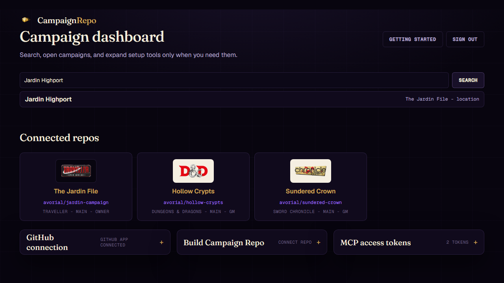
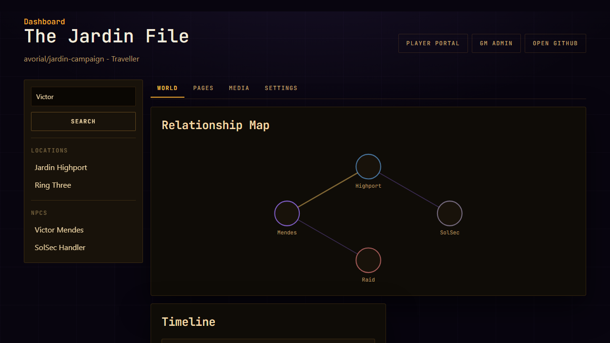

# CampaignRepo

CampaignRepo is a self-hosted campaign manager for tabletop roleplaying games. It turns a GitHub repository or local folder into a shared wiki with session notes, characters, maps, relationships, quests, and a player portal.

Campaign content stays in portable Markdown, YAML, JSON, and media files. The app adds editing, search, permissions, publishing, and optional AI assistance; you can still read and edit the repository without it.

## Start Here

- **Run the app:** [Quick start](#quick-start) or [Docker](#docker).
- **Set up a campaign:** [Campaign setup](#campaign-setup).
- **Edit campaign files directly:** [Repository structure](#repository-structure) and [Refresh and repair](#refresh-and-repair).
- **Connect an AI client:** [AI and MCP](#ai-and-mcp).
- **Follow development:** [Roadmap](ROADMAP.md) and [future ideas](ROADMAP-IDEAS.md).

## What You Can Do

| Area | Capabilities |
| --- | --- |
| Campaign wiki | Markdown editing and previews, wiki links, aliases, backlinks, categories, cover images, galleries, and transclusion |
| Characters | Game-specific templates, rendered character sheets, source-preserving imports, and supported dice rollers |
| Sessions | Agendas, attendees, dates, notes, pinned clues, handouts, and report pages |
| Quests | Objectives, status, participants, locations, arcs, and faction clocks |
| Maps | Image maps with linked pins, nested map links, discovery state, and GM/player layers |
| Relationships | Typed relationship graphs and a dedicated family-tree view |
| Worldbuilding | Custom calendars, timelines, lexicons, manuscripts, and canvas boards |
| Organization | Media management, bulk page edits, filters, full-text search, and campaign health checks |
| Collaboration | Owner, GM, and player roles; invitations; reviews; assignments; watches; and notifications |
| Publishing | Approved player-visible pages, public campaign sites, individual share links, a world gallery, and campaign cloning |
| Portability | Local-folder or GitHub storage, import tools, and ZIP/JSON backups |
| AI tools | Optional generation, campaign Q&A with citations, and an MCP endpoint for external clients |

Any game can use the wiki. Built-in template packs cover fantasy, modern, science-fiction, and generic systems. Sheet features vary by system; Traveller currently has the most complete editor and dice-roller workflow. See [the game-system catalog](lib/templates.ts) and [the roadmap](ROADMAP.md) for current coverage and remaining work.

### Screenshots





More views: [page editor](docs/screenshots/editor.png), [GM review queue](docs/screenshots/review-queue.png), and [player portal](docs/screenshots/player-portal.png).

## Quick Start

Install the project dependencies and start the development server:

```bash
npm install
npm run dev
```

Open [http://127.0.0.1:3000](http://127.0.0.1:3000).

A new database seeds an administrator account:

| Field | Initial value |
| --- | --- |
| Email | `admin@example.local` |
| Password | `admin` |

The account must change its password before using the dashboard or authenticated APIs. Registration is invitation-only by default. Administrators can create accounts, and GMs can invite players into campaigns.

### Development Commands

```bash
npm run dev        # Development server
npm run typecheck  # TypeScript checks
npm test           # Vitest test suite
npm run build      # Production build
npm start          # Run the production build
```

The application uses Next.js, React, TypeScript, and SQLite. Its database holds accounts, memberships, search data, page caches, and queued work.

## Docker

Run the published image:

```bash
docker compose -f docker-compose.image.yml up -d
```

The image is `ghcr.io/avorial/campaignrepo:latest`. The Compose file maps port 3000 and persists application data in the `campaignrepo-data` volume at `/app/data`.

To build from this checkout:

```bash
docker compose up -d --build
```

Without Compose:

```bash
docker build -t campaignrepo .
docker run -p 3000:3000 -v campaignrepo-data:/app/data campaignrepo
```

For Portainer, use the supplied Compose file. A Git-based stack can track `refs/heads/main` in this repository using `docker-compose.yml`; an image-based stack uses `docker-compose.image.yml`.

### Configuration

| Variable | Purpose |
| --- | --- |
| `APP_URL` | Public application URL, including the scheme |
| `SECURE_COOKIES` | Set to `true` when serving over HTTPS |
| `GITHUB_APP_ID` | GitHub App identifier for manually configured installations |
| `GITHUB_APP_SLUG` | GitHub App slug |
| `GITHUB_APP_PRIVATE_KEY` | App private key; escaped newlines are supported |
| `GOOGLE_CLIENT_ID`, `GOOGLE_CLIENT_SECRET` | Optional Google sign-in credentials |
| `GITHUB_OAUTH_CLIENT_ID`, `GITHUB_OAUTH_CLIENT_SECRET` | Optional GitHub sign-in credentials |
| `ALLOW_OPEN_REGISTRATION` | Set to `1` to permit registration without an invitation |
| `CAMPAIGNREPO_DB` | Optional SQLite database path; defaults to `data/campaignrepo.sqlite` |

OAuth callback URLs are:

- Google: `https://YOUR-HOST/api/auth/oauth/google/callback`
- GitHub OAuth: `https://YOUR-HOST/api/auth/oauth/github/callback`

GitHub OAuth sign-in requests repository access and can supply the user's GitHub connection. A GitHub App is a separate connection option with access limited to selected repositories.

## Campaign Setup

From the dashboard, choose a game system and create or connect a campaign:

1. **Local folder:** Create or connect a folder accessible to the server. No GitHub account is required.
2. **GitHub repository:** Connect an existing repository, or create one using a connected personal token.
3. **Starter content:** CampaignRepo initializes the required configuration, templates, starter pages, indexes, and README when missing.

A local folder is on the machine running CampaignRepo, which may differ from the machine running your browser. If using Docker, mount any local campaign directories into the container.

### GitHub App Connection

The dashboard's **Connect GitHub** flow can create the GitHub App through GitHub's manifest setup:

1. Sign in as a global administrator.
2. Connect GitHub and complete the App setup.
3. Select the repositories the installation may access.
4. Return to CampaignRepo and connect the campaign.

CampaignRepo stores the App configuration in SQLite and uses short-lived installation tokens. GitHub App access can connect existing repositories; creating repositories requires a personal-token connection.

For manual App setup, use the application URL as the homepage and `https://YOUR-HOST/api/github/app/callback` as the callback and setup URL. Grant repository **Contents: read/write** and **Metadata: read-only**, then configure the `GITHUB_APP_*` variables.

## Repository Structure

The application repository contains the software. Each campaign has its own content repository or local folder:

```text
README.md
.campaignrepo/
  index.json
wiki/
  campaign.yaml
  pages/
  media/
    media.json
  templates/<game-type>/
  imports/characters/
  sessions/
  quests/
  maps/
  search/
    index.json
```

Additional tools create their own content files as needed. Template folder names are sanitized for filesystem compatibility, so a system such as `Vampire: The Masquerade` uses a Windows-safe directory name.

Markdown pages and their YAML frontmatter are the source of truth. Media files and the JSON/YAML records used by other campaign tools are portable too. The navigation manifest, search snapshot, and SQLite page cache are generated state.

### Writing Pages

Pages belong in `wiki/pages/<Slug>.md` and begin with YAML frontmatter:

```markdown
---
name: The Old Observatory
category: location
type: location
summary: An abandoned observatory above the harbor.
tags:
  - location
visibility: players
approvalStatus: approved
knownToPlayers: true
keyLinks: []
aliases: []
---

# The Old Observatory

The observatory overlooks [[Harbor District]].

:::gm
The keeper still watches the harbor from beneath the dome.
:::
```

Use `[[Page Name]]` or `[[Page Name|label]]` for wiki links. Media links use paths such as `/wiki/media/observatory.png`. Preserve frontmatter when editing files outside the app.

### Article Images

Articles use one title and summary, followed by the page's authored sections. A primary image defaults to a full, uncropped sidebar portrait; an existing matching sidebar image takes precedence over a duplicate cover. On narrow screens, the sidebar moves above the article text. Image links open the full image in a new browser tab, including keyboard and middle-click activation. Media responses identify supported image formats explicitly and serve them inline rather than as generic downloads.

The editor's image-placement setting maps to `coverDisplay`: `auto` or `portrait` for the sidebar, `banner` for a full-width uncropped image, and `none` to suppress only the generated primary image. Authored body images and galleries remain intact.

### Visibility and Reviews

A page must be both `visibility: players` and `approvalStatus: approved` to appear in player views. GM-only blocks, protected summary text, source-import metadata, and hidden relationships are stripped from player reads. Keep private motives and scene instructions inside `:::gm` blocks; Health flags explicitly labeled private sections left outside those blocks.

AI-created pages and imported drafts normally wait for GM review. Owners and GMs decide which content becomes player-visible. Authenticated player portals, published no-login campaign sites, and individual share links are different sharing options.

These controls apply to content served by CampaignRepo. They do not restrict access to raw files on GitHub or in a shared folder; use repository and folder permissions appropriate to the material stored there.

## Refresh and Repair

After editing or pushing files outside CampaignRepo, click **Refresh repo**. It reloads page source, rebuilds the search and navigation indexes, and tells the open campaign views to reload their data. The shared button is available on campaign routes, including newly created campaigns. Unsaved editor drafts are preserved.

The **Maintenance** menu in campaign settings groups search, synchronization, and repair commands. Health offers index repair alongside its scan results. **Refresh repo** remains directly available:

| Control | Purpose |
| --- | --- |
| Refresh repo | Read current source, rebuild indexes, and update the open view |
| Rebuild search | Rebuild full-text search and the portable search/navigation snapshots |
| Repair indexes | Re-parse source pages, rebuild the cache and indexes, and report verification results |
| Sync now | Flush queued local page edits to Git |
| Repair structure | Create missing required folders and starter files |

GitHub-backed page editing uses a local working copy with queued synchronization. Some operations still write directly to repository storage. Check sync status and campaign health when work has not reached Git or when a view disagrees with the source files.

Generated indexes can be rebuilt. Do not replace real campaign content with an index snapshot.

Background sync and index rebuild jobs stay queued until completion. Failures
retry after five minutes with backoff capped at one hour; Health shows queued
work and the last error. Conflicts require review instead of repeated retries.
After a restart, page-list requests recover overdue work; there is no separate
always-running queue worker or cross-process execution lease.

## Imports and Backups

The import/export hub supports character JSON, Foundry actors and journals, Obsidian, Notion, Google Docs exports, CSV, Roll20, LegendKeeper, World Anvil, and other supported world/journal exports. Imported character sources can be retained for comparison during later updates.

Export a campaign as ZIP or JSON to preserve its content and settings. Back up the application database separately: it contains accounts, access controls, App configuration, and other server state that is not part of a campaign repository.

GitHub-backed campaigns offer repository commit history and page diff/restore workflows. A local-folder campaign does not require Git.

## AI and MCP

AI features are optional. Configure an OpenAI-compatible endpoint for page generation and campaign Q&A, or connect an external client to the MCP JSON-RPC endpoint at `/api/mcp`.

MCP tools cover campaign search, page reads and drafts, bulk changes, templates, media, relationships, review queues, and repository setup. Personal API tokens are managed from the dashboard.

Review generated facts, links, and visibility before sharing them. An index refresh updates discovery; it does not approve drafts.

## Project Status

CampaignRepo has a broad working feature set, with ongoing work on synchronization, recovery, imports, and system-specific sheets. Some map controls and collaboration features remain partial. The [roadmap](ROADMAP.md) distinguishes shipped features from unfinished work.

The software is licensed under the [MIT License](LICENSE). Campaign content and third-party game material retain their own applicable rights and licenses.
